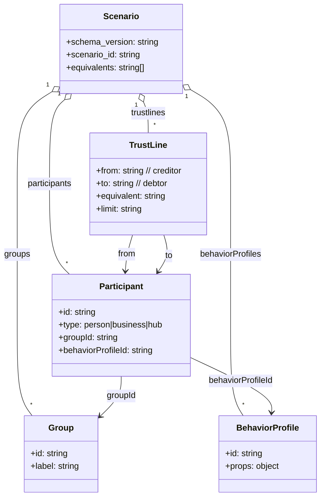
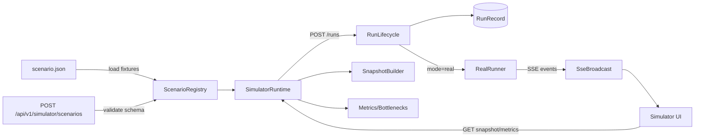
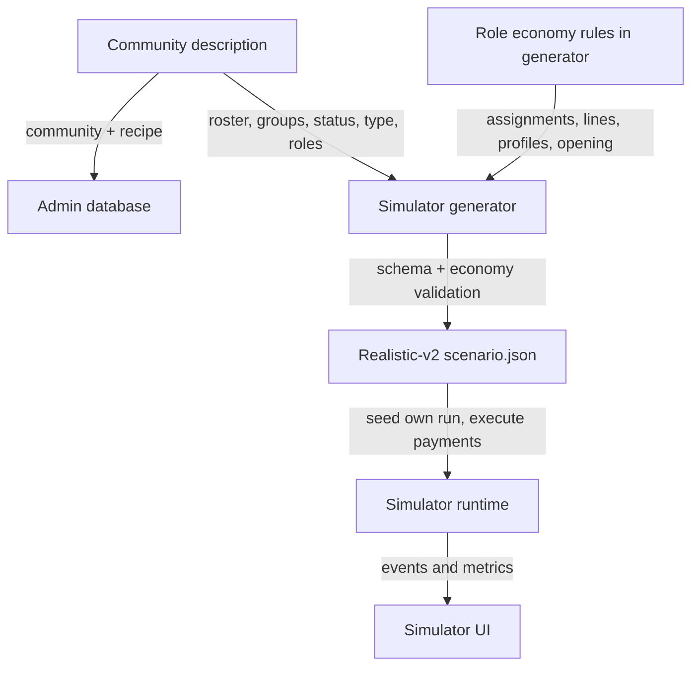
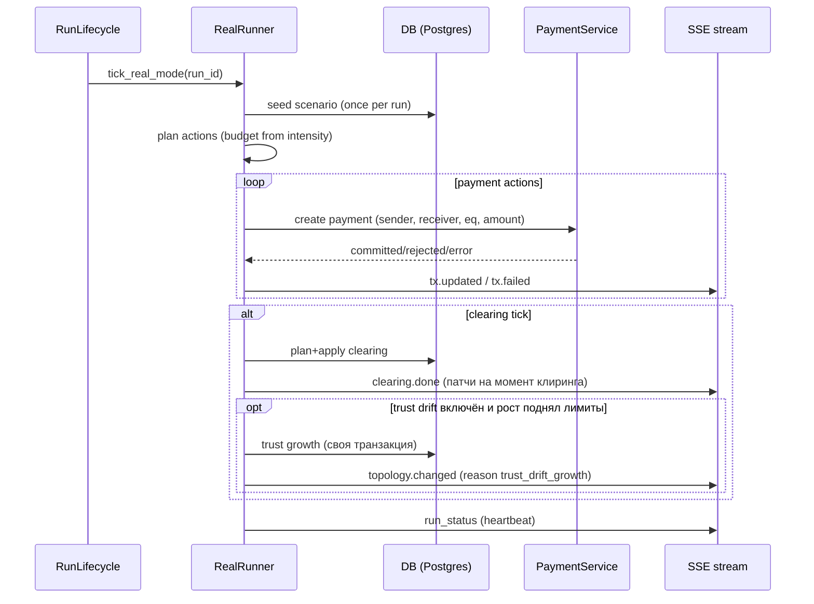

# Сценарии симулятора и движок запуска (RU)

Цель документа:
- **Часть 1 (для всех):** простыми словами — что такое сценарий и как его запустить.
- **Часть 2 (для технарей):** техническое устройство — сущности, верхнеуровневые алгоритмы, структура JSON, файлы движка, точки конфигурации.

См. также:
- Индекс симулятора: [README.md](README.md)
- Online-анализ проблем экономики сети (insights/уведомления): [network-economy-analyzer-spec.md](network-economy-analyzer-spec.md)
- Входной формат (schema): [../../../fixtures/simulator/scenario.schema.json](../../../fixtures/simulator/scenario.schema.json)
- Примеры сценариев: [../../../fixtures/simulator/](../../../fixtures/simulator/)

---

## Часть 1 — для пользователей (простыми словами)

### Что такое «сценарий»
Сценарий — это **описание мира**: участники, кредитные связи и правила поведения. Он также может содержать события, например стартовые платежи realistic-v2.

В сценарии описано:
- **кто участвует** (участники: люди/бизнесы/хабы);
- **какие лимиты доверия** между ними (trustlines = кредитные лимиты);
- **в каких эквивалентах** (UAH/HOUR/…);
- (опционально) группы/профили поведения — как «роли» в экономике.

Дальше сценарий запускает **один и тот же движок симулятора**, который в «тиках» (шаги времени) пытается генерировать платежи/клиринг на основе правил и ограничений.

### Режим запуска
В API есть `mode`, и он один — **Real mode** (серверный режим `fixtures` удалён 2026-10-16, программа 042: явный `mode=fixtures` — `422`, без `mode` создаётся `real`). Демо без сервера на статических снимках (Sandbox в UI) — клиентская функция и серверного режима не использует.

**Real mode**
- Это режим, где runner делает реальные вызовы в backend (payments/clearing), и события отражают реальные результаты.
- Для реалистичной проверки (конкурентность, локи, таймауты) предпочтительнее Postgres + Redis.

Подробный runbook: [backend/real-mode-runbook.md](backend/real-mode-runbook.md).

### Greenfield и Riverside — это разные сценарии, а не разные «скрипты»
Для каждого набора вроде **Greenfield Village** или **Riverside Town** обычно создаётся:
- отдельная папка с `scenario.json` в [../../../fixtures/simulator/](../../../fixtures/simulator/)
- но **движок один и тот же**

То есть «ещё один скрипт» писать не нужно, если вы не меняете сам алгоритм движка.

### Как добавить/запустить новый сценарий (практика)
Самый простой путь:
1) Скопировать один из примеров, например [../../../fixtures/simulator/greenfield-village-100-realistic-v2/scenario.json](../../../fixtures/simulator/greenfield-village-100-realistic-v2/scenario.json)
2) Поменять `scenario_id` на новый уникальный
3) Отредактировать участников и trustlines
4) Запустить backend + UI, затем выбрать сценарий в UI

Важно про список сценариев в UI:
- По умолчанию UI показывает демо-набор (включая realistic v2).
- Если вы добавили новый сценарий и не видите его в списке, выставьте env:
  - `SIMULATOR_SCENARIO_ALLOWLIST=all`
  - или `SIMULATOR_SCENARIO_ALLOWLIST=greenfield-village-100-realistic-v2,my-new-scenario`

Технически это фильтр в runtime (см. [../../../app/core/simulator/runtime_impl.py](../../../app/core/simulator/runtime_impl.py)).

### Чек‑лист: создать, проверить, запустить (1 страница)

**A) Создать сценарий**
1) Выберите основу:
  - минимальный: [../../../fixtures/simulator/minimal/scenario.json](../../../fixtures/simulator/minimal/scenario.json)
  - “похож на реальный”: [../../../fixtures/simulator/greenfield-village-100-realistic-v2/scenario.json](../../../fixtures/simulator/greenfield-village-100-realistic-v2/scenario.json)
  - realistic v2 (UAH-only): [../../../fixtures/simulator/greenfield-village-100-realistic-v2/scenario.json](../../../fixtures/simulator/greenfield-village-100-realistic-v2/scenario.json)

Примечание для realistic v2:
- глобальный `SIMULATOR_REAL_AMOUNT_CAP` по умолчанию не задан (`None`); суммы задают модель роли и доступная ёмкость. Явный положительный cap — opt-in, выставлять 500 для запуска не требуется.
2) Скопируйте в новую папку:
  - `fixtures/simulator/<your-scenario-id>/scenario.json`
3) Обязательные инварианты (частые ошибки):
  - `trustlines[].from → trustlines[].to` = creditor → debtor (направление нельзя «переворачивать»)
  - у каждого trustline должен быть `equivalent`
  - `trustlines[].equivalent` должен входить в `equivalents[]` (если используете `equivalents[]`)
  - для real mode: участники должны быть объявлены в сценарии; runner создаст их в БД под идентичностями прогона (см. §2.4)

Практическое правило для прямого ручного платежа:
- чтобы создать **новый долг с нуля**, без встречного долга, прямым платежом `From=A` → `To=B`, нужна активная линия **`B → A`** с достаточным доступным лимитом: получатель кредитует отправителя; trustline всегда creditor → debtor.
  Пример новой покупки: «Алиса покупает у Магазина» означает платёж `alice → shop`, поэтому при нулевых долгах нужен trustline `shop → alice`.
  Если B уже должен A, платёж A→B может погасить этот встречный долг без создания линии B→A, пока у пары есть активная линия хотя бы в одном направлении. Доступную сумму определяет [pair_capacity](../../../app/core/payments/capacity.py): лимит B→A минус долг A→B плюс долг B→A.

Правила «реалистичных сценариев» (realistic-v2) и чек-лист требований к входным данным:
- [realistic-scenarios.md](realistic-scenarios.md)

**B) Проверить формат (schema)**

Формальная схема: [../../../fixtures/simulator/scenario.schema.json](../../../fixtures/simulator/scenario.schema.json)

Практика в репо:
- генератор seed‑сценариев всегда проверяет JSON Schema и баланс модели экономики, в том числе при `--out-root`; подробности — [правила модели](realistic-scenarios.md#6-генерация-и-проверка-модели)

Команда (Windows):

```powershell
./.venv/Scripts/python.exe scripts/generate_simulator_seed_scenarios.py
```

**C) Запустить и посмотреть в UI**

Рекомендуемый быстрый запуск полного стека (Backend + Admin UI + Simulator UI):

```powershell
./scripts/run_full_stack.ps1 -Action start
```

Если нужно пересоздать базу лаунчера (PostgreSQL `geov0_dev_<DbSlug>`) и заново
исполнить рецепт демо‑сообщества:

```powershell
./scripts/run_full_stack.ps1 -Action start -ResetDb -SeedCommunity riverside-town-50
```

Если сценарий не виден в списке UI:
- выставьте `SIMULATOR_SCENARIO_ALLOWLIST=all` (или перечислите нужные id через запятую)

**D) Альтернатива: загрузить сценарий через API (без git‑изменений)**

Control plane поддерживает upload (с 044 `T4405` — только администратор, заголовок `X-Admin-Token`):
- `POST /api/v1/simulator/scenarios` (body: `{ "scenario": { ...scenario.json... } }`)

Загруженные сценарии сохраняются локально в `.local-run/simulator/scenarios/<scenario_id>/scenario.json` (путь по умолчанию; корень состояния задаётся `SIMULATOR_STATE_DIR`, см. `backend/run-storage.md`, раздел 4.2) и подхватываются runtime.

---

## Часть 2 — для технарей (сущности, алгоритмы, структура)

### 2.1 Сущности верхнего уровня

- **Scenario** — входной JSON, который описывает топологию и параметры (см. schema).
- **Participant** — узел графа: `person|business|hub`.
- **TrustLine** — направленный лимит `from → to`.
  - Семантика важная и фиксированная: `from` = creditor, `to` = debtor.
- **Equivalent** — “валюта/единица”, по которой строятся отдельные графы.
- **Run** — экземпляр прогона сценария (имеет `run_id`, `seed`, `tick_index`, `mode`, `intensity_percent`, состояние).
- **Events** — поток событий для UI (SSE): `run_status`, `tx.updated`, `tx.failed`, `clearing.*`, …
- **Snapshot / Metrics / Bottlenecks** — агрегаты, которые UI запрашивает отдельными endpoint’ами.

Модель событий/снапшотов: [backend/simulator-domain-model.md](backend/simulator-domain-model.md).
Online-анализ («что не так с экономикой сети» поверх метрик/бутылочных горлышек): [network-economy-analyzer-spec.md](network-economy-analyzer-spec.md).

Связи сущностей (упрощённо):



### 2.2 Где живёт движок (основные файлы)

Ключевые точки:
- Runtime “фасад”: [../../../app/core/simulator/runtime_impl.py](../../../app/core/simulator/runtime_impl.py)
- Жизненный цикл run: [../../../app/core/simulator/run_lifecycle.py](../../../app/core/simulator/run_lifecycle.py)
- Реестр сценариев + schema validation: [../../../app/core/simulator/scenario_registry.py](../../../app/core/simulator/scenario_registry.py)
- Real mode runner: [../../../app/core/simulator/real_runner_impl.py](../../../app/core/simulator/real_runner_impl.py), тик — [../../../app/core/simulator/tick.py](../../../app/core/simulator/tick.py)
- SSE broadcast + replay buffer: [../../../app/core/simulator/sse_broadcast.py](../../../app/core/simulator/sse_broadcast.py)
- Snapshot builder: [../../../app/core/simulator/snapshot_builder.py](../../../app/core/simulator/snapshot_builder.py)
- Artifacts (events.ndjson и др.): [../../../app/core/simulator/artifacts.py](../../../app/core/simulator/artifacts.py)

API слой (control plane): [../../../app/api/v1/simulator.py](../../../app/api/v1/simulator.py)

### 2.3 Поток данных: от scenario до UI



### 2.4 Real mode (единственный серверный режим)

Серверный режим `fixtures` (генератор «визуальных» событий без платежей, `fixtures_runner.py`) удалён 2026-10-16, программа 042; сравнение «fixtures vs real» потеряло предмет.

**Real mode** (см. [../../../app/core/simulator/real_runner_impl.py](../../../app/core/simulator/real_runner_impl.py) и [../../../app/core/simulator/tick.py](../../../app/core/simulator/tick.py)):
- (Один раз на run) сидит сценарий в БД и потом выполняет тик‑цикл.
- На тике планирует платежи (budget от intensity) и вызывает PaymentService.
- Может запускать клиринг:
  - **static cadence:** каждые `N` тиков (`SIMULATOR_CLEARING_EVERY_N_TICKS`) — единственная периодическая политика (адаптивная удалена 2026-09-28, программа 021, стадия 3)
  - **по стопору, вне расписания (054-A-7a, решение владельца 2026-10-30):** см. «Стопор: все автоплатежи отвергнуты» ниже.

**Стопор: все автоплатежи отвергнуты (054-A-7a, решение владельца 2026-10-30).** Отказ платежа — штатный исход сюжета, а не ошибка прогона: он идёт в `rejected_total`, не в `errors_total`, и прогон из-за него в `error` не уходит. Счётчик `consec_all_rejected_ticks` (`run_status`, `GET /runs/{id}`) растёт на тике, который пытался платить (что-то запланировал), не провёл ни одного платежа без единой ошибки и получил **хотя бы один** отказ самого сюжета: нет маршрута, нет ёмкости или маршрут нарушает политику линии (коды `ROUTING_*`; `SCENARIO_REFUSAL_CODES`, `app/core/simulator/rejection_codes.py`) — что бы ни было с остальными его платежами: в прогоне с двумя эквивалентами остановка одного не глушит стопор другого. Тик с проведённым платежом или с ошибкой его обнуляет. Тик без единого отказа сюжета — все отказы из-за эквивалента, остановленного оператором или удержанного для целостности (`details.reason` из `MoneyBoundary.MONEY_STOP_REASONS`), участника, выведенного из оборота, неверного ввода, — или прерванный остановкой прогона, нейтрален, как пустая доля бюджета (049 S2a): счётчик не растёт и не обнуляется, и после повторного запуска эквивалента продолжается с прежнего значения (уточнение ревью 054-A-7a, слово владельца 2026-10-30: остановка оператором и удержание целостности — другое состояние, не исчерпанный сюжет). Скриптовые платежи сюжета считаются по тому же правилу, что автоматические; отказ скриптового платежа, чей отправитель ещё не введён сюжетом (036 B1), — отказ самого сюжета и считается, как и раньше.
- На **третьем** таком тике подряд (`STALL_CLEARING_AFTER_TICKS`, `app/core/simulator/tick.py`) тик сразу запускает обычный проход клиринга по эквивалентам прогона — тот же, что по расписанию, но вне него. `CLEARING_ENABLED=false` проход отключает (шаг ниже всё равно наступает); `SIMULATOR_CLEARING_EVERY_N_TICKS=0` — нет: этот проход не периодический. Строка лога INFO `simulator.real.stall_clearing run_id=… tick=… consec_stall_ticks=3`. Проход засчитывается и тогда, когда он не завершился (жёсткий таймаут, сбой прохода, ещё идущий клиринг прошлого тика): шаг ниже наступает всё равно.
- Если следующий засчитанный тик снова ничего не провёл, сценарию больше нечего делать самому: прогон переходит в `paused` с `pause_reason: "scenario_exhausted"` (в `run_status` и в `GET /runs/{id}`); строка лога WARNING `simulator.run.scenario_exhausted run_id=… tick=… ticks=…`. Если же между ними прошёл хоть один платёж, счётчик обнулился и всё начинается заново.
- На такой паузе heartbeat не тикает, а ручные действия Interact (`payment-real`, линии, клиринг) работают как на любой паузе. `resume` возвращает прогон в работу и обнуляет счётчик и `pause_reason`; обычная пауза пользователем `pause_reason` не ставит (`null`), `stop` и `restart` его сбрасывают. Причина паузы хранится только в памяти процесса, как `stop_reason`: в `simulator_runs` колонки для неё нет.
- До 054-A-7a прогон в таком состоянии продолжал тикать: каждый пятый тик писалось предупреждение `simulator.real.all_rejected_stall` (убрано), а UI показывал плашку «попробуйте клиринг».

**Свои участники у каждого прогона (044 `T4405`, 2026-10-17).** Прогон при создании получает свежих участников: каждому участнику, объявленному сценарием (включая участников `add_participant` в событиях), даётся идентичность прогона `<run_id>:p<порядковый номер>` ([../../../app/core/simulator/run_perimeter.py](../../../app/core/simulator/run_perimeter.py), `bind_run_identities`), и в частной копии сценария прогона переписываются все типизированные ссылки на участника: концы линий, `policy.blocked_participants`, платежи сценария, `anchor`, `focus`, `expected_cycle`, `sponsor`, концы `create_trustline`, цель `freeze_participant`. Группы, профили и подписи не трогаются; шаблон не меняется; имя участника — как в сценарии, а без имени — исходный pid. Ссылка на необъявленного участника отклоняет запуск (409 `SCENARIO_INVALID`). `/restart` сохраняет идентичности и долги. Сидер принимает существующую строку только с идентичностью своего прогона (`RunIdentityUnbound` иначе), поэтому строки, оставленные другим или старым прогоном под теми же pid, не принимаются. Всё, что отдаёт прогон (узлы снимка, Interact-действия, значения SSE, артефакты), — эти идентичности; имена событий и формы SSE не меняются. Публичное демо работает на отдельной одноразовой базе: участники, линии и долги прошлых прогонов не удаляются автоматически (посылка 044, решение 9 советника).

**Допуск сценариев (044 `T4405`).** Не-администратор запускает и читает (деталь, превью) только сценарии из списка (`SIMULATOR_SCENARIO_ALLOWLIST`); остальные отвечают 404, как неизвестные. Загрузка сценария (`POST /simulator/scenarios`) — только администратор. Превью сценария — картинка шаблона, без чтения базы.

### 2.5 Tick‑модель и детерминизм

Верхнеуровневое описание алгоритма runner: [backend/runner-algorithm.md](backend/runner-algorithm.md).

Практика в коде (Real mode):
- `tick_seed = (seed * 1_000_003 + tick_index) & 0xFFFFFFFF`
- для действий внутри тика делается производный `action_seed`

Это снижает “дрейф” случайности при изменениях нагрузки.

### 2.6 Структура `scenario.json` (поля и смысл)

Формальная схема: [../../../fixtures/simulator/scenario.schema.json](../../../fixtures/simulator/scenario.schema.json)

Ключевые поля:
- `schema_version` — версия формата входного JSON.
- `scenario_id` — строковый идентификатор.
- `name`, `description` — метаданные.
- `seed` — опционально, для детерминизма (если движок/контроль‑plane начнёт его использовать как вход).
- `equivalents: string[]` — список эквивалентов.
  - Практика runtime: граф и события строятся по `trustlines[].equivalent`, а `equivalents[]` используется как список режимов/фильтров.
- `participants[]`:
  - `id` — идентификатор шаблона; real mode привязывает его к свежей идентичности прогона и создаёт участника при сидировании (§2.4).
  - `type` — `person|business|hub`.
  - `status` — влияет на сидирование/фильтрацию (зависит от seed‑логики).
  - `groupId` — логическая роль (anchors/producers/…).
  - `behaviorProfileId` — привязка к профилю поведения.
- `trustlines[]`:
  - `from`/`to` — строго creditor→debtor.
  - `equivalent` — эквивалент ребра.
  - `limit` — лимит (строкой, чтобы не терять точность).
  - `policy` — произвольный объект (в т.ч. статус/auto_clearing).
- `groups[]`, `behaviorProfiles[]`, `events[]`:
  - Допускаются схемой как расширение.
  - На текущем этапе часть из них может не интерпретироваться планировщиком (см. раздел 2.7).

Подробное пояснение schema + MVP допущений: [backend/scenario-schema.md](backend/scenario-schema.md).

### 2.7 Профили, события и границы планирования

[Планировщик](../../../app/core/simulator/real_payment_planner.py) использует `tx_rate`, `equivalent_weights`, `recipient_group_weights`, `amount_model[eq]` и flow-настройки. `tx_rate` — относительный вес в бюджете действий; `flow_chains` даёт предпочтение первого шага к группе (`chain[1]`), а не исполняет полный цикл торговли. Кольца realistic-v2 создаёт [модель экономики](realistic-scenarios.md#2-потоки-и-постоянные-контрагенты) на уровне назначенных участников.

Планировщик проверяет статическую политику маршрута через импортированные правила пары, сопоставляет агрегатный долг с суммой лимитов и предпочитает пригодных прямых соседей целевой группы. Размер ограничивают модель суммы, шаг эквивалента, агрегатная доступность и ёмкость прямой пары; динамическую ёмкость непрямого маршрута проверяет роутер. Поэтому запланированный платёж может быть отказан. `SIMULATOR_REAL_AMOUNT_CAP` по умолчанию `None`; только явный положительный cap добавляет глобальный потолок, применяемый в шаге каждого эквивалента ([app/config.py](../../../app/config.py)).

`events[]` исполняются: stress влияет на веса планировщика, а [tick.py](../../../app/core/simulator/tick.py) обрабатывает scripted `payment`, `inject` и `clearing`. Инъекции требуют разрешения процесса. Стартовые платежи realistic-v2 — обычные события `payment` на тактах 1–20; они исполняются и при интенсивности 0. `/restart` повторяет их поверх сохранённых долгов; отказы допустимы. Подробности — [opening и рестарт](realistic-scenarios.md#4-как-появляются-стартовые-долги).

Общие механизмы профилей описаны в [behavior-model-spec.md](backend/behavior-model-spec.md); текущие правила двух realistic-v2 сценариев — в [realistic-scenarios.md](realistic-scenarios.md).

### 2.8 Где лежат сценарии и как они попадают в runtime

Загрузка сценариев:
- fixtures: [../../../fixtures/simulator/*/scenario.json](../../../fixtures/simulator/)
- uploaded: `.local-run/simulator/scenarios/<scenario_id>/scenario.json` (по умолчанию)

Валидация:
- При upload через API выполняется JSON Schema validation (см. `validate_scenario_or_400`).

### 2.9 Как генерируются seed-сценарии (Greenfield/Riverside)

#### 2.9.1 Состав сообщества и два пути подготовки данных

Человекочитаемый замысел и общие правила состава находятся в [seed-документах](../seeds/README.md); общие поля переноса — в [fixtures-mapping.md](backend/fixtures-mapping.md). Утверждения этих справок о совпадении топологий community и симулятора для realistic-v2 исторические: текущие линии задают [правила модели 050](realistic-scenarios.md) и [генератор](../../../scripts/generate_simulator_seed_scenarios.py). Машиночитаемые входы — `seeds/communities/<id>/community.json` и `recipe.json`. С программы 050 важно различать два мира:

| Поверхность | Откуда берётся состав | Откуда берутся линии и долги |
|---|---|---|
| Admin UI / база после рецепта | Описание сообщества | Линии community и настоящие операции recipe |
| Realistic-v2 симулятора | Тот же состав, группы, типы, статусы, описательные роли | Генератор выводит линии из назначенных ролевых потоков; долг создают стартовые платежи сценария и дальнейшая торговля |

Линии community в realistic-v2 не переносятся. Это принятое разделение 050, решение 9; подробности и границы долга — [два мира одного сообщества](realistic-scenarios.md#1-два-мира-одного-сообщества). Рецепт админки не является подготовительным шагом для запуска сценария симулятора.

#### 2.9.2 Генератор и контракт результата

[generate_simulator_seed_scenarios.py](../../../scripts/generate_simulator_seed_scenarios.py) детерминированно строит:

- назначения конкретных контрагентов по роли и обратные им trustlines creditor→debtor;
- профили «роль × число контрагентов», модели сумм и предпочтения получателей;
- opening из обычных `payment`-событий, stress, warmup и trust drift.

Контракт формы — [scenario.schema.json](../../../fixtures/simulator/scenario.schema.json); правила экономики и измерения — [realistic-scenarios.md](realistic-scenarios.md). Профили и граф выводятся из общих правил генератора, отдельного сохранённого реестра назначений нет. Frozen остаются в составе без потоков модели.

#### 2.9.3 Практический процесс

Для изменений состава или ролей сначала измените описание сообщества, сверив замысел с [общими правилами состава seed-данных](../seeds/README.md), с оговоркой об исторической топологии из §2.9.1. Изменения потоков и профилей realistic-v2 принадлежат генератору; изменение административных линий/рецепта — отдельная поверхность.

Сначала сгенерируйте результат вне каноничных fixtures:

```powershell
./.venv/Scripts/python.exe scripts/generate_simulator_seed_scenarios.py --out-root .local-run/scenario-preview
```

Для согласованной регенерации двух tracked сценариев:

```powershell
./.venv/Scripts/python.exe scripts/generate_simulator_seed_scenarios.py
```

Обе команды выполняют JSON Schema и проверку баланса через настоящую `plan_payments` до публикации каждого файла. Validation subprocess получает изолированные ENV/state и task PostgreSQL URL; соединение с БД для офлайн-проверки не открывается. `--out-root` меняет только место вывода, не набор проверок. Параметры cohort и пороги — [§6 правил модели](realistic-scenarios.md#6-генерация-и-проверка-модели).

Затем поднимите стек и выберите сценарий в Simulator UI:

```powershell
./scripts/run_full_stack.ps1 -Action start
```

Runtime сам засевает участников и линии выбранного сценария. Если сценария нет в списке — проверьте `SIMULATOR_SCENARIO_ALLOWLIST` (список id или `all`). Публичный сценарий посетителя по умолчанию остаётся `clearing-demo-10`; realistic-v2 не становится default от регенерации. Отдельный путь подготовки базы **для Admin UI**:

```powershell
./.venv/Scripts/python.exe scripts/seed_db.py --source recipe --community riverside-town-50
```

После изменения экономики проверяйте и офлайн-планы, и живое исполнение: [команды измерителя и границы метрик](realistic-scenarios.md#7-что-измерять).

#### 2.9.4 Два пути от описания к работающему миру



#### 2.9.5 Что означает seed-сценарий

Это воспроизводимый эталонный набор симулятора: одинаковые входы и правила генератора дают одинаковые файлы. Он служит опорой для сравнения движка и визуализации на одном графе, но не обещает совпадения с топологией административного рецепта. RNG seed прогона — отдельный параметр.

#### 2.9.6 Владельцы правил

- Замысел, общие поля состава и административный рецепт: [seeds/README.md](../seeds/README.md), `seeds/communities/<id>/community.json`, `recipe.json`; прежние утверждения о единой топологии не применяются к realistic-v2 (§2.9.1).
- Экономика realistic-v2 и способы проверки: [realistic-scenarios.md](realistic-scenarios.md).
- Реализация модели: [генератор](../../../scripts/generate_simulator_seed_scenarios.py), `ROLE_FLOW`, `economy_model`, `behavior_profiles`, `opening_events`.
- Форма сценария: [scenario.schema.json](../../../fixtures/simulator/scenario.schema.json).

### 2.10 Конфигурация runtime (env vars)

Основные knobs (см. [../../../app/core/simulator/runtime_impl.py](../../../app/core/simulator/runtime_impl.py)):
- `SIMULATOR_TICK_MS_BASE` — виртуальная длительность тика.
- `SIMULATOR_ACTIONS_PER_TICK_MAX` — верхний лимит budget действий.
- `SIMULATOR_CLEARING_EVERY_N_TICKS` — cadence клиринга в real mode.
- `SIMULATOR_REAL_CLEARING_TIME_BUDGET_MS` — необязательный мягкий бюджет прохода: по умолчанию `0`, неположительное значение отключает дедлайн. Обычный проход завершается по правилам раннера; положительное число миллисекунд явно включает прежнюю отсечку между циклами. Независимый `SIMULATOR_REAL_CLEARING_HARD_TIMEOUT_SEC` по умолчанию равен 60 с; аварийная отмена не зависит от мягкого бюджета. Это порог запроса отмены, а не гарантия точного wall time: уже начатый commit сначала устанавливает свой исход, затем публикуется известный результат. Источники — [app/config.py](../../../app/config.py), [tick.py](../../../app/core/simulator/tick.py) и [clearing/runner.py](../../../app/core/clearing/runner.py).
- `SIMULATOR_SCENARIO_ALLOWLIST` — фильтр списка сценариев для UI; с 044 `T4405` — и допуск запуска и чтения сценария для не-администратора.

SSE replay buffer:
- `SIMULATOR_EVENT_BUFFER_SIZE`
- `SIMULATOR_EVENT_BUFFER_TTL_SEC`
- `SIMULATOR_SSE_SUB_QUEUE_MAX`

Replay correctness не переключается env-флагом: любой переданный
`Last-Event-ID`, который нельзя полностью и упорядоченно восстановить, всегда
получает `HTTP 410`.

Real mode guardrails:
- `SIMULATOR_REAL_AMOUNT_CAP` — опциональный положительный cap, default `None`.
- `SIMULATOR_REAL_MAX_IN_FLIGHT`
- `SIMULATOR_REAL_MAX_TIMEOUTS_PER_TICK`
- `SIMULATOR_REAL_MAX_ERRORS_TOTAL`
- `SIMULATOR_CLEARING_MAX_DEPTH`

### 2.11 Последовательность одного тика (Real mode)



**Порядок клиринга и роста доверия (039 D-fix, 2026-10-19).** Внутри эквивалента тик публикует сначала
`clearing.done` — его `node_patch`/`edge_patch` прочитаны сразу после коммита клиринга, лимиты ещё не выросли, — затем
закрытые клирингом линии (`topology.changed` с `removed_edges`, если есть), и только потом выполняет рост доверия по
затронутым рёбрам; рост, поднявший хотя бы один лимит, публикует `topology.changed` с `reason: "trust_drift_growth"` и
патчем всех рёбер эквивалента. Имена и формы событий не менялись, изменился только порядок: до 2026-10-19 рост шёл
**перед** `clearing.done`, его патч уже нёс долги после клиринга, и интерфейс, снимающий «клиринг: было X → стало Y»
вокруг патчей `clearing.done`, после автоматического клиринга пары не показывал. Ручной клиринг (`actions/clearing-real`)
доверие не растит. Держит порядок `tests/integration/test_p039_dfix_clearing_done_precedes_trust_growth_postgres.py`.

### 2.12 Ошибки: где логгируются и как их расшифровывать

В симуляторе есть **две принципиально разные категории “плохих” исходов**:
- **Ожидаемые отказы (rejections)**: платеж “не прошёл” по бизнес‑причинам (нет маршрута, не хватает лимитов и т.п.). Это нормальная часть динамики сети.
- **Ошибки выполнения (errors)**: таймауты, неожиданные исключения, падения тика, ошибки инфраструктуры. Эти события сигналят о проблемах движка/стека, а не сценария.

Ниже — где всё это видно и как читать.

#### 2.12.1 Где смотреть (UI, SSE, artifacts, backend logs, DB)

**1) В UI (Simulator UI)**
- Панель run показывает `state` и (если run упал) `last_error` из события `run_status`.
- События `tx.failed` всплывают как “красные/жёлтые” сигналы на графе: это может быть как rejection, так и error.

**2) В SSE (поток событий)**
- Истина по событиям — это то, что пришло в stream: `tx.failed`, `run_status`, `clearing.*`.
- Для `tx.failed` самое важное поле — `error`:
  - `error.code` — нормализованный код причины (для UI/аналитики)
  - `error.details` — “сырые” детали (класс исключения, GEO‑код, HTTP‑статус и т.п.)

См. протокол: [backend/ws-protocol.md](backend/ws-protocol.md).

**3) В artifacts (`events.ndjson` + status/summary)**
- Все SSE‑события пишутся в `events.ndjson` (best‑effort).
- Локальный путь (dev, по умолчанию): `.local-run/simulator/runs/<run_id>/artifacts/events.ndjson`.
- Там же лежат `status.json`, `last_tick.json`, а при finalize — `summary.json` и `bundle.zip`.

См. где хранится и как устроено: [backend/run-storage.md](backend/run-storage.md).

**4) В backend logs**
- Движок логгирует исключения и предупреждения через стандартный `logging`.
- Полезные “якоря” по строкам логов:
  - `simulator.real.tick_failed` — тик real mode упал (с `exc_info=True`).
  - `simulator.storage.*` — проблемы записи run/метрик/артефактов в БД.
  - `simulator.artifacts.*` — проблемы создания/записи `events.ndjson` и финализации bundle.
  - `simulator.fixture_scenario_load_failed` / `simulator.uploaded_scenario_load_failed` — сценарий не загрузился.

**5) В DB (если включено хранение run state)**
- У run есть счётчики и последнее состояние:
  - `errors_total` — количество *ошибок выполнения* (см. ниже про отличие от rejections)
  - `last_error` (JSON) — “последняя фатальная/важная ошибка” (для `run_status`)

См. схему хранения: [backend/run-storage.md](backend/run-storage.md).

#### 2.12.2 Как отличить rejection от error

Практическое правило для real mode:
- **Rejection** обычно приходит как `tx.failed`, но при этом это *не* “ошибка движка”:
  - в `error.details` часто есть `status_code` в диапазоне `4xx` (клиентская бизнес‑ошибка)
  - `errors_total` при этом не увеличивается
- **Error** (таймаут/исключение) обычно:
  - увеличивает `errors_total`
  - обновляет `run_status.last_error`
  - может приводить к `run_status.state="error"` при превышении guardrails

#### 2.12.3 Примеры типовых ошибок и что они означают

Ниже примеры “что это нам говорит” — чаще всего это либо сигнал о топологии сценария, либо сигнал о проблеме стека.

**A) `tx.failed.error.code=ROUTING_NO_ROUTE`**
- Что это: нет маршрута в графе trustlines от отправителя к получателю.
- Что говорит о сценарии:
  - граф разорван (нет пути),
  - перепутано направление trustline (должно быть creditor → debtor),
  - неверный `equivalent` (в этом эквиваленте ребёр меньше/нет).

**B) `tx.failed.error.code=ROUTING_NO_CAPACITY`**
- Что это: путь есть, но по доступной ёмкости он не проходит (лимиты/доступное < сумма).
- Что говорит:
  - лимиты слишком маленькие для текущих долгов,
  - clearing слишком редкий/неэффективный,
  - сценарий создаёт слишком “горячие” узлы (узкие места) — это может быть ожидаемо.

**C) `tx.failed.error.code=TRUSTLINE_LIMIT_EXCEEDED`**
- Что это: конкретный trustline не выдерживает попытку (перелив через лимит).
- Что говорит:
  - либо лимит/политика trustline слишком строгие,
  - либо планировщик подбирает суммы слишком большие для текущей топологии.

**D) `tx.failed.error.code=TRUSTLINE_NOT_ACTIVE`**
- Что это: trustline/политика помечены как неактивные.
- Что говорит:
  - сидирование/fixtures создали часть ребёр неактивными,
  - или вы ожидаете ребро активным, но в данных оно выключено.

**E) `tx.failed.error.code=PAYMENT_TIMEOUT`**
- Что это: таймаут на уровне платежного стека.
- Что говорит:
  - перегрузка/локи/транзакции,
  - проблемы инфраструктуры (Postgres/Redis),
  - слишком высокий `intensity_percent` относительно ресурсов.

**F) `tx.failed.error.code=INTERNAL_ERROR`**
- Что это: непредвиденная ошибка сервера (5xx/исключение вне ожидаемых бизнес‑отказов).
- Что говорит:
  - потенциальный баг, транзакционное состояние “aborted”, проблемы с сессией/локами,
  - нужно смотреть backend logs по времени события и `error.details`.

**F2) `tx.failed.error.code=INTEGRITY_VIOLATION` (с 2026-10-30, 054-A-7b)**
- Что это: ядро отказало в платеже тика, потому что нарушен инвариант протокола или данных (`IntegrityViolationException`: `TRUST_LIMIT_VIOLATION`, `PAYMENT_DELTA_DRIFT`, `PENDING_CLOSE_PAIR_NOT_REDUCED` и т. п.; имя — в `error.details.details.invariant`). Это **ошибка**, а не отказ сюжета: считается в `errors_total`, не в `rejected_total`, и прогон останавливается сразу — `state="error"`, `last_error.code=INTEGRITY_VIOLATION`; денежная фаза тика откатывается целиком. На каждый такой платёж — строка лога ERROR `simulator.real.payment_integrity_violation run_id=… tick=… tx_id=… invariant=…`.
- До 054-A-7b такой отказ (ответ 409) считался обычным отказом с кодом `PAYMENT_REJECTED`, и прогон продолжал тикать.
- Что говорит: дефект писателя денег или повреждённые данные; разбор — по строке лога с тем же `tx_id`. `resume` такой прогон не возвращает (`409`, см. H) — только `restart`.

**G) `tx.failed.error.code=PAYMENT_REJECTED`**
- Что это: “обобщённый” отказ, когда детали не удалось стабильно промаппить в более конкретный код.
- Что говорит:
  - это почти всегда про данные в `error.details` (там обычно есть `exc`, `geo_code`, `status_code`).

**H) `run_status.state="error"` + `last_error.code=REAL_MODE_TOO_MANY_TIMEOUTS|REAL_MODE_TOO_MANY_ERRORS|REAL_MODE_TICK_FAILED_REPEATED|REAL_MODE_MONEY_NO_PROGRESS|INTEGRITY_VIOLATION|HEARTBEAT_FAILED`**
- Что это: сработали guardrails и run принудительно остановлен как аварийный.
- **Второго шанса нет (054-A-7c, решение владельца 2026-10-30).** Для `REAL_MODE_TOO_MANY_ERRORS`, `REAL_MODE_TOO_MANY_TIMEOUTS`, `REAL_MODE_TICK_FAILED_REPEATED`, `REAL_MODE_MONEY_NO_PROGRESS` и `INTEGRITY_VIOLATION` `resume` отвечает `409` (`details.reason = run_failed_terminal`, `details.code` — этот код) и прогон не трогает: он снова сделал бы то же самое. Вернуть в работу — `restart` (или новый прогон). Остальные коды `error` — `HEARTBEAT_FAILED`, `SCENARIO_TRUSTLINE_REFUSED`, `SIMULATOR_PID_TAKEN` и прочие — `resume` возвращает, как и раньше. Список — `RESUME_REFUSED_ERROR_CODES` в `app/core/simulator/run_lifecycle.py`.
- Код остановки — итоговый факт прогона: с 054-A-7c `last_error` остановленного прогона не перезаписывается кодами его платежей, отменённых вместе с остановленной фазой (до этого после остановки по бюджету в `last_error` оказывался `INTERNAL_ERROR` или `PAYMENT_TIMEOUT` последнего платежа). Коды самих платежей — в их `tx.failed`.
- Что говорит:
  - `REAL_MODE_TOO_MANY_TIMEOUTS`: деградация стека/локи/ресурсная нехватка.
  - `REAL_MODE_TOO_MANY_ERRORS`: систематическая ошибка исполнения (например, постоянные `INTERNAL_ERROR`).
  - `REAL_MODE_TICK_FAILED_REPEATED`: тик падает исключением несколько раз подряд (часто баг или транзакционное “poisoning”).
  - `HEARTBEAT_FAILED` (программа 034, F-034-10, 2026-10-08): исключение в самой итерации heartbeat — вне
    обработки ошибок тика (публикация статуса, реестр ранов, сбой внутри обработчика упавшего тика). Действует
    в обоих режимах (`real` и `fixtures`). Повтора нет: ран сразу `error`, тиков больше не будет; вернуть его в
    работу — `resume`. `last_error.message` несёт **только тип исключения** (`The heartbeat failed: <Type>`);
    текст исключения наружу не уходит, он в логе: строка `simulator.heartbeat.failed run_id=<id>` с трейсбеком.
    До 034 такое исключение молча завершало задачу heartbeat, и ран оставался `running` без тиков.

**H2) `run_status.state="error"` + `last_error.code=SCENARIO_TRUSTLINE_REFUSED` (с 2026-10-10, дефект D1)**
- Что это: засев сценария в базу отказал в линии доверия самого сценария по **названной** причине, которая сама не
  проходит, — конец линии не `active`, эквивалент остановлен или удержан, политика вне грамматики, лимит мельче шага
  эквивалента. Повтор через тик встретит тот же отказ, пока кто-то не вмешается, поэтому ран останавливается на
  первом же тике, а не после трёх с `REAL_MODE_TICK_FAILED_REPEATED`, как было раньше; `resume` засевает заново.
- Чем это **не** является: не всякий отказ в линии сценария останавливает ран. Отказ `CONCURRENT_TRUSTLINE_CREATE` —
  ту же линию только что закоммитил другой ран того же сценария — и отказ, которому сервис линий причины не назвал,
  идут прежним путём: `REAL_MODE_TICK_FAILED`, ран `running`, следующий тик находит линию и засевает. Список причин,
  проходящих сами, один и явный: `ScenarioTrustLineRefused.CLEARS_BY_ITSELF`
  (`app/core/simulator/real_scenario_seeder.py`).
- Что говорит: `last_error.message` несёт линию и причину — `SCENARIO_TRUSTLINE_REFUSED: trust line <from>-><to> <EQ>:
  <текст> (reason: <причина>)`; в логе строка `simulator.real.run_refused code=SCENARIO_TRUSTLINE_REFUSED`. Тот же
  отказ в режиме Interact — ответ `409` с тем же кодом. Счётчик упавших подряд тиков не растёт; `errors_total`
  увеличивается на единицу — сама остановка.
  Причина `participant_suspended` у сценария, который сам по себе исправен, означает состояние, оставшееся в базе
  от прежнего рана: участник заморожен, а линия к нему закрыта или ещё не создана.

**H3) `run_status.state="paused"` + `pause_reason="scenario_exhausted"` (с 2026-10-30, 054-A-7a)**
- Что это: не ошибка. Четыре засчитанных тика подряд не провели ни одного автоплатежа (в каждом хотя бы один отказ по маршруту, ёмкости или политике линии), а клиринг, запущенный после третьего, не помог; тики, где отказал только остановленный оператором или удержанный эквивалент, не засчитываются (см. «Стопор» в разделе 2.4). `errors_total` и `last_error` не меняются.
- Что говорит: сценарий упёрся в свои лимиты — платить больше нечем, пока что-то не изменится (новая линия, поднятый лимит, ручной платёж назад, клиринг). Последние `tx.failed` в `events.ndjson` показывают коды отказов (обычно `ROUTING_NO_CAPACITY`). Вернуть в работу — `resume`.

**I) `last_error.code=REAL_MODE_TICK_FAILED`, но run ещё `running`**
- Что это: один тик упал исключением, но runner пытается продолжить (до порога “подряд”).
- Что говорит:
  - часто это “всплеск” из‑за конкуренции/локов или единичная ошибка сессии,
  - если повторяется — будет `REAL_MODE_TICK_FAILED_REPEATED` и run станет `error`.

Практический флоу расследования:
1) Найти последний `tx.failed` в `events.ndjson` и посмотреть `error.code` + `error.details`.
2) Если run перешёл в `error`, смотреть `run_status.last_error` (это итоговый “стоп‑код”).
3) Сопоставить `ts` события с backend logs (якоря `simulator.real.*`, `simulator.storage.*`).
4) Если причина — routing/лимиты: проверять направление trustlines, связность, лимиты и cadence clearing.

#### 2.12.4 Мини‑пример: как выглядит `tx.failed` в данных

Пример (сокращённо; реальные события содержат `event_id`, `ts` и др.):

```json
{
  "type": "tx.failed",
  "equivalent": "HOUR",
  "from": "p_alice",
  "to": "p_bob",
  "error": {
    "code": "ROUTING_NO_ROUTE",
    "message": "ROUTING_NO_ROUTE",
    "details": {
      "exc": "RoutingException",
      "geo_code": "E001",
      "status_code": 400,
      "message": "No route"
    }
  }
}
```

Как читать:
- `error.code` — быстро классифицирует причину (нормализованный слой UI/аналитики).
- `error.details.*` — помогает точно понять первопричину (исключение/код/статус), и именно туда надо смотреть при расследовании.

---

### 2.13 Сюжетный сценарий `community-story-10` (036, срез C)

[`fixtures/simulator/community-story-10/scenario.json`](../../../fixtures/simulator/community-story-10/scenario.json) — не «мир, который живёт сам», а **рассказ из 12 эпизодов** о том, как работает сеть взаимного кредита. 10 жителей плюс Дмитро, которого вводит `inject`; один эквивалент `UAH`; `tick_seconds` 2.5; последний эпизод на 58-м тике, то есть около 2.4 минут номинального сна между тиками (работа тика сверху, паузы не считаются). Формат полей эпизода (`caption`, `pause_after`, `focus`, `anchor`, `expected_cycle`, `settings.playback`) — [`backend/scenario-schema.md`](backend/scenario-schema.md).

| № | Время (тик) | Тип | Кто → кому, сумма | Пауза | Что показывает |
|---|---|---|---|---|---|
| 0 | 3 000 (3) | `note` | — | да | знакомство: десять жителей, видно только доверие |
| 1 | 8 000 (8) | `payment` | Олена → Пекарня, 40.00 | да | покупка напрямую: долг Олены Пекарне 40 |
| 2 | 13 000 (13) | `payment` | Тарас → Ферма, 60.00 | да | покупка через посредника: Тарас должен Магазину, Магазин — Ферме |
| 3 | 18 000 (18) | `payment` | Ферма → Млин, 50.00 | нет | накопление долгов |
| 4 | 23 000 (23) | `payment` | Пекарня → Млин, 30.00 | нет | накопление долгов: цепочки, не круг |
| 5 | 28 000 (28) | `inject` | `add_participant` Дмитро (Магазин ему доверяет, он доверяет Млину) | да | новый участник и доверие к нему (`topology.changed`) |
| 6 | 33 000 (33) | `payment` | Млин → Дмитро, 40.00 | нет | долг Млина Дмитру |
| 7 | 38 000 (38) | `payment` | Дмитро → Магазин, 40.00 | да | долги замкнулись: Магазин → Ферма → Млин → Дмитро → Магазин |
| 8 | 43 000 (43) | `clearing` | `expected_cycle` Ферма, Магазин, Дмитро, Млин | да | круг уменьшен на 40 по каждому звену «до/после»: долги Млин → Дмитро и Дмитро → Магазин исчезли, Магазин → Ферма 60 → 20, Ферма → Млин 50 → 10 |
| 9 | 48 000 (48) | `inject` | `freeze_participant` Тарас | да | заморозка участника: его долг Магазину 60 остаётся на виду |
| 10 | 53 000 (53) | `payment` | Петро → Нина, 25.00 | да | отказ: у Нины нет ни одной линии доверия, платёж не может до неё дойти (`ROUTING_NO_ROUTE`), ничего не сдвинуто |
| 11 | 58 000 (58) | `note` | — | да | итог |

Итоговые долги (должник → кредитор): Олена → Пекарня 40, Тарас → Магазин 60, Магазин → Ферма 20, Ферма → Млин 10, Пекарня → Млин 30. Идентификаторы участников в сценарии — `cs_<имя>` (отдельный префикс, чтобы не пересекаться с другими сценариями в одной базе); `name` — для показа.

**История одноразовая и требует трёх предусловий, которых человек, выбравший сценарий из списка, не получает. Поэтому в список по умолчанию её нет** (решение 2026-10-09; `_scenario_allowlist` в `app/core/simulator/runtime_impl.py`). Она в реестре всегда и становится выбираемой существующим переопределением `SIMULATOR_SCENARIO_ALLOWLIST=community-story-10` (или `*`); в список по умолчанию её добавит сессия S9 вместе с потоком запуска, который обеспечивает предусловия. Паузы `pause_after` уже работают, а оверлея подписей в UI ещё нет (034 S9): ран, запущенный без подготовки, встаёт на паузу девять раз без объяснения.

**Предусловия запуска и что бывает без них** (каждое поведение ниже исполнено, а не выведено; держится тестами `tests/integration/test_p036_c_community_story_postgres.py`, кроме интенсивности 30):
- **Флаг инъекций.** Эпизоды 5 и 9 — `inject`: нужен `SIMULATOR_REAL_ENABLE_INJECT=1`. По умолчанию флаг 0, и канонический `scripts/run_full_stack.ps1` (≈:1375) сам ставит 0. Без флага: эпизоды 5 и 9 — `refused` с причиной `inject_disabled_by_process` (одна заметка в артефакте событий и запись в `episode_progress`), Дмитро не появляется, поэтому эпизоды 6 и 7 — `refused` (`PAYMENT_REJECTED`), круг не замыкается, а эпизод 8 — `done`, `cleared_cycles` 0 и `reason: "expected_cycle_not_cleared"`; эпизод 10 по-прежнему `refused` (`ROUTING_NO_ROUTE`). История доходит до конца, пауз столько же, `incomplete` нет — но её подписи уже неверны. Сценарий сам `inject_enabled: true`; это согласие, не разрешение: потолок — флаг процесса.
- **Интенсивность 0.** Её даёт умолчание сценария (`settings.playback.intensity_percent`), если клиент **не шлёт** число. Simulator UI шлёт число всегда: интенсивность из хранилища, а сохранённый `0` (его держал удалённый режим Interact) отбрасывается при чтении и заменяется на 30 (`simulator-ui/v2/src/composables/useSimulatorApp.ts`, поле `intensityPercent`; 043 S3, 2026-10-17); режима Interact, принудительно ставившего 0, больше нет (043 S2). **Нынешний UI сам интенсивность 0 не устанавливает и не сохраняет;** вручную ввести 0 в поле Intensity под «Подробнее» (поле принимает 0, значение уходит в запрос как есть — по чтению `TopBar.vue` и `useSimulatorRealMode.ts`, в браузере не исполнялось; BACKLOG 043-19) можно, но после перезагрузки страницы сохранённый 0 снова заменяется на 30. При 30 фоновые платежи двигают долги до первого эпизода (измерено ревью: 8 долгов до эпизода 1, эпизоды 2 и 6 отказаны `ROUTING_NO_CAPACITY`, 66 `tx.updated` вместо 6); тестом это не закреплено — фон недетерминирован.
- **Чистая база.** Перезапуск истории — **не** `restart` и не просто новый ран: ран засевает сценарий в базу, а долги, `suspended` у Тараса и участник Дмитро остаются в ней. Второй ран на той же базе: Дмитро есть в базе, но вне периметра этого рана, Тарас заморожен, инъекции пропущены **без слов** (применённая или ничего не нашедшая инъекция в прогрессе не значится), эпизоды 2 и 6 — `refused` (`ROUTING_NO_ROUTE`), 7 — `refused` (`PAYMENT_REJECTED`), эпизод 8 — `done` с `expected_cycle_not_cleared`, а долги растут (Олена → Пекарня уже 80). Повтор истории требует чистой базы.

**Объявленные ограничения и почему история построена именно так** (остатки B1, `specs/BACKLOG.md` 036-2):
- *Периодический клиринг не отключается сценарием.* Он идёт на каждом тике, кратном `SIMULATOR_CLEARING_EVERY_N_TICKS` (по умолчанию 25: тики 25, 50, 75), и может забрать цикл эпизода раньше скриптового клиринга. Поэтому в истории на тиках 25 и 50 циклов нет: круг замыкается на тике 38 и гасится на тике 43, между ними кратных 25 нет. Если поменять расписание эпизодов или период, правило надо перепроверить: его держит `tests/unit/test_p036_c_community_story_shape.py`. Справка `run_full_stack.ps1` (≈:63) приводит примером именно `SIMULATOR_CLEARING_EVERY_N_TICKS=10`: при 10 (а равно при 20 и 40) тик 40 забирает круг, замкнувшийся на тике 38; долги в конце те же, но клиринг эпизода 8 ничего не погасил — и теперь говорит это (`reason`, ниже). Исполнено для 10.
- *Порядок внутри тика задаёт тип события, а не `time`:* сначала `inject`, затем `payment`, затем `clearing`. Эпизоды разнесены на 5 тиков, на одном тике ничего не конкурирует.
- *Скриптовый клиринг может закончиться `incomplete`* в штатный бюджет прохода (5000 мс) и доделаться следующим тиком; эпизод тратится только на `done`, и пауза наступает после него. Исполняющий тест ждёт `done` и не зависит от числа тиков.
- *Эпизод 10 — отказ по замыслу.* Статус `refused` (`ROUTING_NO_ROUTE`) и `tx.failed` — ожидаемый исход, а не поломка; ран при этом не останавливается.
- `expected_cycle` записан в порядке рёбер «кредитор → должник» (как `cycle_edges` и `cycles[].edges` в `episode_progress`): Ферма → Магазин → Дмитро → Млин → Ферма.
- **Правдивость клиринга с `expected_cycle`.** Событие `clearing` с объявленным `expected_cycle`, чей завершённый проход не погасил этот цикл, по-прежнему `done` и потрачено (проход завершён), но запись в `episode_progress` несёт `reason: "expected_cycle_not_cleared"`. Сравниваются множества рёбер «кредитор → должник» (соседние пары списка и последняя с первой; поворот цикла совпадает, обратное направление — нет) среди циклов, которые событие погасило в этом запуске суммарно; сумма не сравнивается (у объявления её нет). У события без `expected_cycle` ничего не меняется.
- *Длительность 2.4 минуты* — номинальная: сумма `tick_seconds` (сон между тиками), работа тика прибавляется сверху, паузы не считаются.
- *Структурная проверка `focus`/`anchor`:* `build_story` (`app/core/simulator/scenario_story.py`, `_reference_and_money_errors`) отказывает на pid в `focus.pids`, концах `focus.edges`, `anchor.from/to` и `expected_cycle`, которых нет среди участников сценария и тех, кого вводит `add_participant`. Порядок («введён раньше, чем назван») и смысловая верность `focus`/`anchor.time_ms` не проверяются.

**Как это проверяется.** `tests/integration/test_p036_c_community_story_postgres.py` прогоняет историю от начала до конца настоящими тиками на PostgreSQL (`runtime.create_run`, продовый heartbeat с виртуальным `sleep`, `runtime.resume` на каждой паузе) и сверяет `episode_progress` и долги в базе после каждой паузы; `tests/unit/test_p036_c_community_story_shape.py` — размер, правило периодического клиринга и allowlist; схему держит `tooling-tests/portable/test_p036_a_scenario_schema_and_the_live_fixtures.py`. **Не сделано в срезе C:** запись событий рана как офлайн-фикстура для плеера (`T3631`) и что-либо в `simulator-ui/**`.

## Ссылки на существующую документацию

- Формат `scenario.json` (описание): [backend/scenario-schema.md](backend/scenario-schema.md)
- Формат `scenario.json` (JSON Schema): [../../../fixtures/simulator/scenario.schema.json](../../../fixtures/simulator/scenario.schema.json)
- Алгоритм runner (верхний уровень): [backend/runner-algorithm.md](backend/runner-algorithm.md)
- Протокол SSE/REST: [backend/ws-protocol.md](backend/ws-protocol.md)
- Интеграция с payment/clearing: [backend/payment-integration.md](backend/payment-integration.md)
- Модель событий/снапшотов/метрик: [backend/simulator-domain-model.md](backend/simulator-domain-model.md)
- Хранение run state + artifacts export: [backend/run-storage.md](backend/run-storage.md)
- Как поднять окружение: [backend/real-mode-runbook.md](backend/real-mode-runbook.md)
